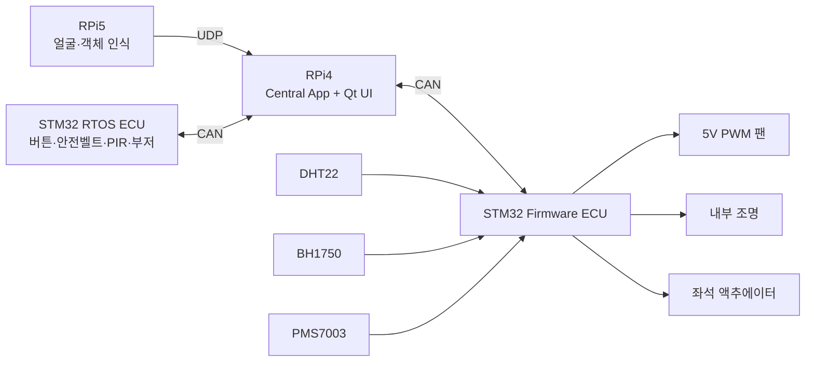
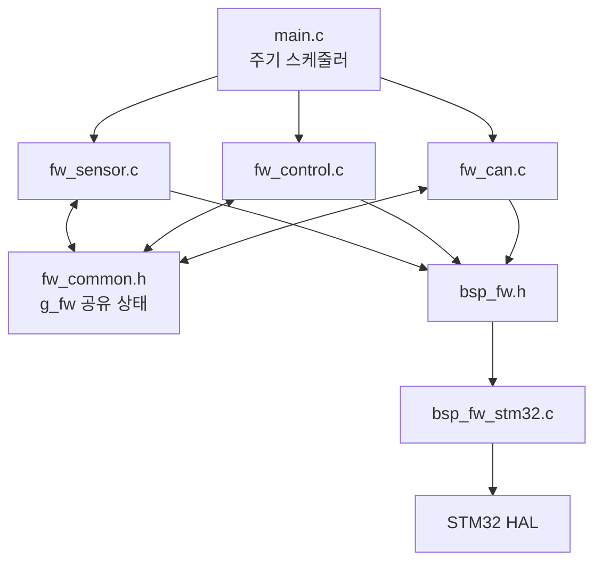

# 어린이 통학차량 안전관리 시스템 — STM32 Firmware ECU

STM32 NUCLEO-F429ZI 기반의 **환경 센싱 및 차량 편의·안전 액추에이터 제어 펌웨어**이다.  
Raspberry Pi 4 중앙 제어기와 CAN으로 통신하며, 차량 내부의 온습도·조도·미세먼지를 측정하고 팬·내부 조명·좌석 액추에이터를 제어한다.

> 이 저장소는 전체 시스템 중 **STM32 Firmware ECU**만 포함한다.  
> 운전자 인증, UI, 시스템 상태 판단, PIR·AI 기반 잔류 아동 최종 판단은 Raspberry Pi 4 및 다른 ECU에서 수행한다.

---

## 1. 주요 기능

- DHT22를 이용한 온도·습도 측정
- BH1750을 이용한 차량 내부 조도 측정
- PMS7003을 이용한 PM1.0·PM2.5·PM10 측정
- 4선식 5V PWM 팬 3단 제어
- 내부 조명 ON/OFF 제어
- 좌석 액추에이터 정·역방향 및 시간 제한 제어
- CAN 수신 명령에 따른 차량 상태·사용자 설정 반영
- 센서 데이터와 액추에이터 상태를 CAN으로 주기 송신
- 잔류 감지 경보 상태에서 일반 설정보다 우선하는 안전 제어 수행

---

## 2. 전체 시스템에서의 역할



STM32 Firmware ECU는 센서 데이터를 수집하고 실제 출력 장치를 구동한다. 잔류 아동 여부는 이 보드가 단독으로 확정하지 않는다. Raspberry Pi 4가 PIR 또는 AI 객체 감지 결과를 종합해 `OP_ALARM` 상태를 전송하면, Firmware ECU가 팬과 내부 조명의 안전 제어를 실행한다.

---

## 3. 개발 환경

| 항목 | 내용 |
|---|---|
| MCU | STM32F429ZIT6 |
| 개발 보드 | NUCLEO-F429ZI |
| IDE | STM32CubeIDE |
| HAL 패키지 | STM32Cube FW_F4 V1.28.3 |
| 언어 | C |
| 시스템 클럭 | 168 MHz |
| 실행 구조 | Bare-metal Super Loop |
| CAN | CAN 2.0A, 11-bit Standard ID, 500 kbps |

FreeRTOS는 사용하지 않는다. `HAL_GetTick()` 기반의 비블로킹 주기 스케줄링으로 센싱·제어·CAN 송신을 수행한다.

---

## 4. 하드웨어 구성 및 핀맵

### 4.1 센서 및 통신

| 기능 | STM32 핀 | 인터페이스 | 비고 |
|---|---|---|---|
| CAN RX | PD0 | CAN1_RX | SN65HVD230 RXD 연결 |
| CAN TX | PD1 | CAN1_TX | SN65HVD230 TXD 연결 |
| BH1750 SCL | PB8 | I2C1_SCL | 7-bit 주소 `0x23` |
| BH1750 SDA | PB9 | I2C1_SDA | GY-302 모듈 기준 |
| DHT22 DATA | PC0 | 1-Wire GPIO | Pull-up 필요 |
| PMS7003 RX | PC11 | UART4_RX | PMS7003 TX 연결 |
| PMS7003 TX | PC10 | UART4_TX | PMS7003 RX 연결 |

### 4.2 액추에이터

| 기능 | STM32 핀 | 주변장치 | 비고 |
|---|---|---|---|
| 팬 PWM | PA6 | TIM3_CH1 | 25 kHz PWM |
| 내부 조명 | PE3 | GPIO Output | MOSFET 구동 권장 |
| 좌석 EN/PWM | PB6 | TIM4_CH1 | 1 kHz PWM |
| 좌석 IN1 | PE0 | GPIO Output | 정방향 제어 |
| 좌석 IN2 | PE2 | GPIO Output | 역방향 제어 |

### 4.3 배선 주의사항

- STM32, 센서, CAN 트랜시버, 팬 전원, 모터 드라이버는 **GND를 공통으로 연결**한다.
- CAN 버스 양 끝에는 120 Ω 종단저항을 각각 하나씩 사용한다.
- 팬과 좌석 액추에이터를 STM32 GPIO에서 직접 구동하지 않는다.
- 팬은 별도 5 V 전원을 사용하고 PWM 제어선만 MCU에 연결한다.
- 좌석 액추에이터는 외부 H-브리지 모터 드라이버와 별도 구동 전원을 사용한다.

---

## 5. 소프트웨어 구조

```text
Core/
├── Inc/
│   ├── bsp_fw.h          # 플랫폼 비의존 BSP 인터페이스
│   ├── fw_common.h       # CAN ID, 상태 enum, 공유 데이터 구조체
│   ├── fw_sensor.h       # DHT22, BH1750, PMS7003 센서 API
│   ├── fw_control.h      # 팬, 내부 조명, 좌석 제어 API
│   └── fw_can.h          # CAN 초기화, RX 파싱, 주기 송신 API
└── Src/
    ├── bsp_fw_stm32.c    # STM32 HAL 기반 BSP 구현
    ├── fw_sensor.c       # 센서 드라이버 및 스트림 파서
    ├── fw_control.c      # 액추에이터 제어 정책
    ├── fw_can.c          # CAN RX ISR 및 TX 패킹
    └── main.c            # 초기화 및 주기 스케줄러
```

### 5.1 계층 구조



애플리케이션 계층은 가능한 한 HAL에 직접 의존하지 않고 BSP 인터페이스를 사용한다. DHT22의 마이크로초 단위 1-Wire 타이밍과 CAN 초기화·수신 콜백만 제한적으로 HAL을 직접 사용한다.

---

## 6. 주기 스케줄링

| 작업 | 호출 주기 | 동작 |
|---|---:|---|
| DHT22 측정 | 2,000 ms | 온도·습도 측정, 약 5 ms 블로킹 |
| 팬 제어 | 500 ms | 안전·수동·자동 우선순위 적용 |
| BH1750 처리 | 500 ms | 명령/읽기 2단계, 실제 갱신 약 1초 |
| PMS7003 처리 | 2,000 ms | UART 링버퍼 기반 비블로킹 파싱 |
| 좌석 제어 | 100 ms | 새 명령 적용 및 구동시간 만료 확인 |
| 내부 조명 제어 | 500 ms | 조도 및 경보 상태에 따른 제어 |
| 환경·먼지 CAN 송신 | 2,000 ms | `0x041`, `0x051` 송신 |
| 액추에이터 상태 송신 | 500 ms | `0x061` 송신 |

---

## 7. 차량 상태 정의

### 7.1 시동·화면 상태

| 값 | 상태 | 설명 |
|---:|---|---|
| `0x00` | `IGN_OFF` | 화면 OFF, 시동 OFF |
| `0x01` | `IGN_DISPLAY` | 화면 ON, 시동 OFF |
| `0x02` | `IGN_ON` | 화면 ON, 시동 ON |

### 7.2 운행 상태

| 값 | 상태 | 설명 |
|---:|---|---|
| `0` | `OP_PARKING` | 시동 OFF, 주차·감시 대기 |
| `1` | `OP_RUNNING` | 운행 중 |
| `2` | `OP_ALARM` | 잔류 감지 경보 상태 |
| `3` | `OP_RESERVED_3` | 예약 |
| `4` | `OP_STOPPED_BOARDING` | 승하차 중 |

`OP_ALARM`의 시작과 해제 권한은 Raspberry Pi 4 중앙 제어기에 있다. Firmware ECU는 PIR 원시값만으로 경보 상태를 자체 확정하지 않는다.

---

## 8. 제어 정책

### 8.1 공통 우선순위

```text
안전 제어 > 사용자 수동 설정 > 자동 제어 > 출력 정지
```

### 8.2 팬 제어

#### 잔류 감지 경보 상태

| 차량 내부 온도 | 팬 단계 | PWM Duty |
|---:|---:|---:|
| 센서 오류 | 1단 | 33% |
| 25.0 ℃ 미만 | 정지 | 0% |
| 25.0~27.9 ℃ | 1단 | 33% |
| 28.0~29.9 ℃ | 2단 | 66% |
| 30.0 ℃ 이상 | 3단 | 100% |

온도 센서가 유효하지 않으면 최소 1단으로 동작하는 fail-safe 정책을 적용한다.

#### 일반 자동 모드

현재 온도와 CAN으로 수신한 목표 온도의 차이를 사용한다.

| `현재 온도 - 목표 온도` | 팬 단계 |
|---:|---:|
| 0 ℃ 이하 | 정지 |
| 0~0.9 ℃ | 1단 |
| 1.0~2.9 ℃ | 2단 |
| 3.0 ℃ 이상 | 3단 |

기본 목표 온도는 25.0 ℃이며 CAN 명령으로 15.0~35.0 ℃ 범위에서 변경한다.

### 8.3 내부 조명 제어

- `OP_ALARM` 상태에서 조도 센서가 유효하지 않으면 fail-safe로 ON 한다.
- `OP_ALARM` 상태에서 측정 조도가 기준보다 낮으면 ON 한다.
- 일반 상태에서는 수동 모드 명령이 있을 때만 ON/OFF 한다.
- 밝기 값은 현재 구현에서 사용하지 않으며 GPIO ON/OFF만 지원한다.

### 8.4 좌석 액추에이터 제어

- 방향: 정지·전진·후진
- PWM Duty: 0~100%
- 최대 구동시간: 5,000 ms
- 구동시간이 0이면 무제한 구동이 아니라 정지로 처리한다.
- 지정 시간이 지나면 자동으로 정지한다.
- 위치 피드백 센서가 없어 목표 위치 값은 현재 사용하지 않는다.

---

## 9. CAN 통신 규약

모든 메시지는 **11-bit Standard Data Frame**이며, 멀티바이트 값은 별도 표기가 없으면 Little-endian이다.

### 9.1 수신 메시지

#### `0x022` — PIR 원시 감지값

| Byte | 내용 |
|---:|---|
| 0 | `0`: 미감지, `1`: 감지 |

PIR 값은 상태 보고에만 사용한다. 경보 latch는 `0x083`의 `OP_ALARM` 상태로만 제어한다.

#### `0x073` — 목표 온도 및 팬 설정

| Byte | 내용 |
|---:|---|
| 0~1 | 목표 온도 ×10, `int16`, LE |
| 2 | 팬 모드: `0` 수동, `1` 자동 |
| 3 | 수동 팬 단계: 0~3 |

#### `0x083` — 시동 및 운행 상태

| Byte | 내용 |
|---:|---|
| 0 | `IgnitionState_t` |
| 1 | `OperationState_t` |

`operation_state == OP_ALARM`이면 안전 경보 latch가 설정되고, 그 외 상태를 수신하면 해제된다.

#### `0x093` — 좌석 제어 명령

| Byte | 내용 |
|---:|---|
| 0 | 방향: `0` 정지, `1` 전진, `2` 후진 |
| 1 | PWM Duty: 0~100% |
| 2~3 | 구동시간 ms, `uint16`, LE |
| 4 | 목표 위치 0~100, 현재 미사용 |

#### `0x0B3` — 내부 조명 설정

| Byte | 내용 |
|---:|---|
| 0 | 모드: `0` 수동, `1` 자동 |
| 1 | 수동 ON/OFF |
| 2 | 밝기 0~100, 현재 미사용 |
| 3~4 | 조도 기준값 ×10, `uint16`, LE |

### 9.2 송신 메시지

#### `0x041` — 환경 센서 데이터

| Byte | 내용 |
|---:|---|
| 0~1 | 온도 ×10, `int16`, LE |
| 2~3 | 습도 ×10, `uint16`, LE |
| 4~5 | 조도 ×10, `uint16`, LE |
| 6 | bit0: 온습도 valid, bit1: 조도 valid |
| 7 | Sequence counter |

조도 값은 CAN 필드 범위를 초과하면 `65535`에서 포화된다.

#### `0x051` — 미세먼지 데이터

| Byte | 내용 |
|---:|---|
| 0~1 | PM1.0, `uint16`, LE |
| 2~3 | PM2.5, `uint16`, LE |
| 4~5 | PM10, `uint16`, LE |
| 6 | 데이터 valid |
| 7 | Sequence counter |

PMS7003의 대기환경(atmospheric environment) 기준 값을 사용한다.

#### `0x061` — Firmware ECU 상태

| Byte | 내용 |
|---:|---|
| 0 | 현재 팬 단계 0~3 |
| 1 | 내부 조명 상태 0/1 |
| 2 | 시동 상태 |
| 3 | 운행 상태 |
| 4 | PIR 원시 감지값 |
| 5 | bit0: 온습도 valid, bit1: 조도 valid, bit2: 먼지 valid |
| 6 | bit0: 안전 경보 latch |
| 7 | Sequence counter |

---

## 10. 빌드 및 다운로드

### 10.1 프로젝트 열기

1. STM32CubeIDE를 실행한다.
2. `File > Import`를 선택한다.
3. `General > Existing Projects into Workspace`를 선택한다.
4. 이 저장소의 루트 디렉터리를 지정한다.
5. 프로젝트 `Firmware`를 Import 한다.

### 10.2 빌드

1. Build Configuration을 `Debug` 또는 `Release`로 선택한다.
2. `Project > Build Project`를 실행한다.
3. 컴파일 오류 없이 `.elf`가 생성되는지 확인한다.

### 10.3 보드 다운로드

1. NUCLEO-F429ZI의 ST-LINK USB를 PC에 연결한다.
2. 보드 전원과 외부 장치 전원을 점검한다.
3. STM32CubeIDE에서 `Run` 또는 `Debug`를 실행한다.
4. 통합 시연에서는 `FW_LOCAL_TEST_MODE`가 반드시 `0`인지 확인한다.

---

## 11. 통합 실행 순서

1. 모든 보드와 외부 전원을 OFF 한다.
2. CAN H/L, 공통 GND, 120 Ω 종단저항을 확인한다.
3. 센서와 액추에이터 배선을 확인한다.
4. STM32 Firmware ECU를 먼저 부팅한다.
5. STM32 RTOS ECU와 Raspberry Pi 4를 부팅한다.
6. Raspberry Pi 4에서 SocketCAN과 중앙 제어 애플리케이션을 실행한다.
7. `0x083` 상태 메시지가 주기적으로 수신되는지 확인한다.
8. `0x041`, `0x051`, `0x061` 메시지가 송신되는지 확인한다.

Linux에서 CAN 메시지를 확인하는 예시는 다음과 같다.

```bash
candump can0
```

특정 ID만 확인하려면 다음과 같이 필터링한다.

```bash
candump can0,041:7FF,051:7FF,061:7FF
```

---

## 12. 로컬 테스트 모드

`Core/Src/main.c`에서 다음 값을 사용한다.

```c
#define FW_LOCAL_TEST_MODE  0u
#define FW_TEST_CASE        0u
```

통합 환경에서는 `FW_LOCAL_TEST_MODE`를 반드시 `0`으로 유지한다. `1`로 설정하면 일부 CAN 수신 상태 대신 테스트 값을 강제로 주입한다.

| Test Case | 시험 내용 |
|---:|---|
| 1 | 운행 상태에서 팬·LED·좌석 시험 |
| 2 | 주차 상태 시험 |
| 3 | `OP_ALARM` 안전 제어 시험 |
| 4 | 승하차 상태 시험 |

---

## 13. 문제 해결

### CAN 데이터가 수신되지 않음

- `FW_CAN_Init()`이 `MX_CAN1_Init()` 이후 호출되는지 확인한다.
- CAN 속도가 모든 노드에서 500 kbps로 같은지 확인한다.
- CAN H/L 역결선 여부를 확인한다.
- 버스 양 끝의 120 Ω 종단저항을 확인한다.
- SN65HVD230의 전원과 공통 GND를 확인한다.

### DHT22가 invalid로 표시됨

- DATA 핀 Pull-up 저항을 확인한다.
- 부팅 후 최소 2초 안정화 시간을 확보한다.
- 측정 주기를 2초보다 짧게 설정하지 않는다.
- 긴 배선이나 노이즈가 있으면 배선을 줄이고 디커플링을 추가한다.

### BH1750 값이 읽히지 않음

- I2C 주소가 `0x23`인지 확인한다.
- SDA/SCL Pull-up 상태를 확인한다.
- PB8과 PB9 배선이 바뀌지 않았는지 확인한다.

### PMS7003 값이 갱신되지 않음

- PMS7003 TX가 STM32 PC11(UART4_RX)에 연결되었는지 확인한다.
- UART 속도가 9600 bps인지 확인한다.
- 6초 이상 유효 프레임이 없으면 `dust_valid`가 0으로 변경된다.

### 팬이 동작하지 않음

- PA6에서 25 kHz PWM이 출력되는지 확인한다.
- 팬 별도 5 V 전원과 공통 GND를 확인한다.
- 4선식 팬의 PWM 선과 FG 선을 혼동하지 않았는지 확인한다.
- 경보 상태에서도 25 ℃ 미만이면 팬이 정지하는 것이 현재 정책이다.

### 좌석 액추에이터가 한 방향만 동작함

- PE0·PE2와 모터 드라이버 IN1·IN2 연결을 확인한다.
- PB6 PWM 출력을 확인한다.
- 모터 전원과 STM32 GND가 공통인지 확인한다.
- `0x093`의 방향·Duty·구동시간 값을 확인한다.

---

## 14. 현재 구현의 제한사항 및 TODO

- 좌석 위치 피드백 센서가 없어 시간 기반 개루프 제어를 사용한다.
- 내부 조명 밝기 제어는 아직 지원하지 않고 GPIO ON/OFF만 사용한다.
- CAN 수신 필터가 현재 accept-all이므로 양산 수준에서는 필요한 ID만 허용하도록 변경해야 한다.
- DHT22 읽기 중 약 4~5 ms 동안 정밀 타이밍을 위해 인터럽트가 잠시 제한된다.
- 팬은 시제품의 환기·공조 대체 장치이며 실제 차량용 HVAC와 동일한 냉각 성능을 제공하지 않는다.
- PIR 원시값은 단독 안전 판단에 사용하지 않는다. 중앙 제어기에서 AI 결과와 함께 판단한다.

### 코드 확인이 필요한 항목

1. `LIGHT_THRESHOLD_X10`의 현재 값은 `1000`이다. 단위가 ×10이므로 실제 기본값은 **100.0 lx**이다. 코드 주석에는 700.0 lx라고 적혀 있어 불일치하므로 최종 기준을 확정한 뒤 상수 또는 주석을 수정해야 한다.
2. `main.c`에는 센서 초기화, PWM 시작, 출력 초기화가 DHT22 안정화 지연 전후로 중복 호출된다. 대부분의 호출은 반복해도 동작하지만 릴리스 전 중복 코드를 정리하는 것을 권장한다.
3. `fw_control.h` 일부 주석은 과거 PIR 직접 판단 구조를 설명하고 있으나 실제 구현은 `OP_ALARM` 기반이다. 구현과 문서 주석을 동일하게 정리해야 한다.

---

## 15. 안전 관련 주의

이 프로젝트는 교육 및 기능 검증을 위한 시제품이다. 실제 어린이 통학차량에 적용하려면 자동차 기능안전, 전자파 적합성, 센서 진단, 전원 이중화, 통신 오류 처리, 오감지·미감지 검증, 차량 규정 및 인증 절차가 추가로 필요하다.

본 시스템은 운전자의 직접 확인 책임을 대체하지 않으며, 잔류 아동 사고 위험을 줄이기 위한 보조 시스템으로 사용해야 한다.
